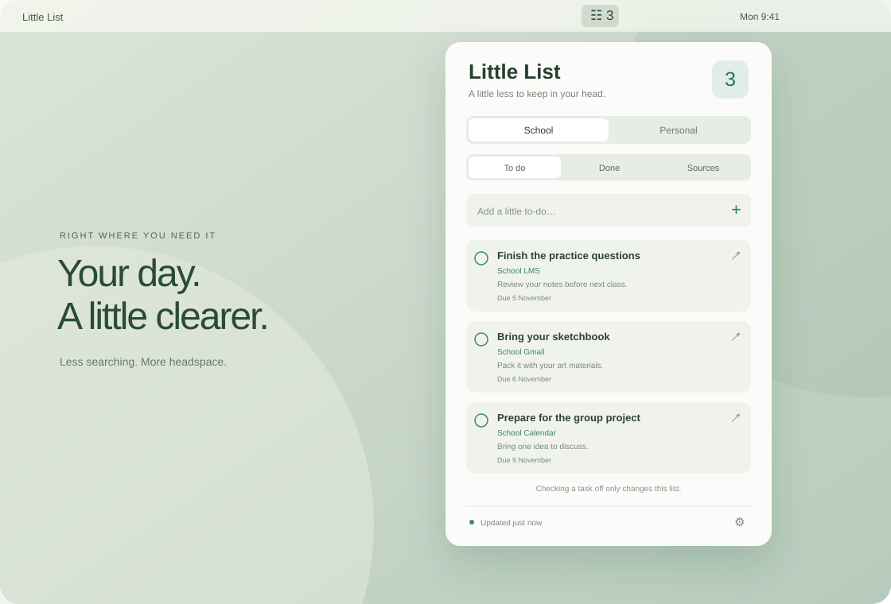
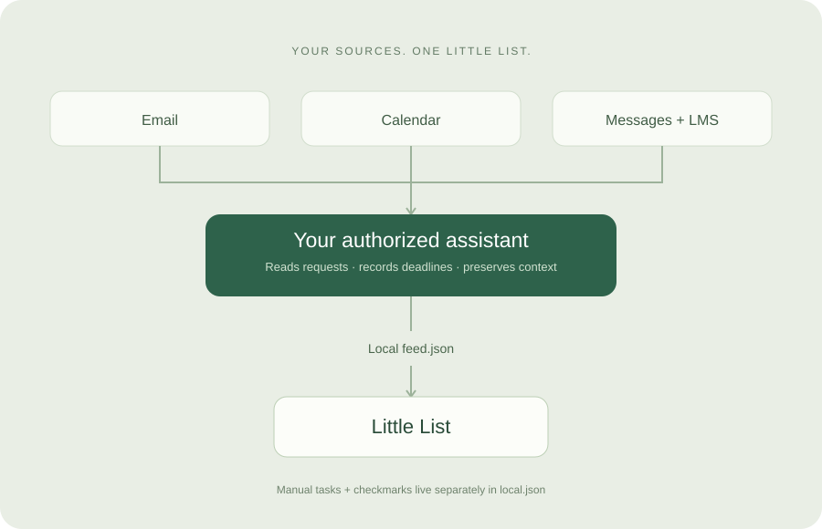

# Little List

### A little less to keep in your head.

Little List is a native macOS menu bar app that brings requests, assignments and deadlines into two simple lists: **School** and **Personal**. Open it from the menu bar, see what needs doing, and jump straight to the original source.

## What it does

- Keeps School and Personal tasks separate, with To do, Done and Sources views.
- Lets you add tasks, check them off and restore them locally.
- Links imported tasks back to their original messages or assignments.
- Shows each source’s coverage and last successful check.
- Offers an optional Open at login setting.

The app is built with SwiftUI and AppKit, without third-party app libraries. It reads a local JSON feed every five seconds. A separate AI assistant with authorized account access maintains that feed; the app itself does not connect to accounts or run an AI model.

The reference workflow checks personal and school Gmail, school Google Calendar, Google Chat, WhatsApp and a school LMS such as Teamie. Availability depends on your assistant’s connectors and computer-use tools. A 15-minute refresh is periodic scanning, not instant push or a standalone background sync service.

## Get started

You need macOS 14 or newer, Apple Command Line Tools and an assistant that can work with local files to automate installation. Apple Silicon is tested; the guide includes an Intel build target that still needs verification.

1. Download [Little-List-Setup-Guide.md](Little-List-Setup-Guide.md).
2. Attach the file to your AI assistant and paste the request below.
3. Let it check compatibility, build the app with a blank feed, and verify the interface.
4. Choose which accounts it may read, then verify the first refresh in **Sources**.

### Use the setup guide with your AI

> Use the attached Little List setup guide to help me install the app. First check my operating system and your available local-file, shell, connector, computer-use and scheduling tools. Build with a blank feed before connecting accounts. Ask which sources I authorize and verify their identities. Keep School and Personal separate, preserve my local tasks, and never send messages or submit work. If you cannot install or schedule updates on my computer, give me the manual steps and explain what remains to be done.

The guide is self-contained: it includes the complete app source, build script, feed format, refresh contract and verification steps. A browser-only chat may be able to explain the process without being able to install software or update files on your Mac. For manual installation, save the guide’s source blocks as the named files and follow its build instructions.

## Local data and honest sync

Runtime files live in `~/Library/Application Support/LittleList/`:

| File | Purpose |
| --- | --- |
| `feed.json` | Imported tasks and per-source freshness; maintained by the assistant |
| `local.json` | Manual tasks and completed IDs; maintained by the app |

Completion changes only Little List; it does not submit assignments or mark remote work complete. Failed checks retain old data, and Sources should say what was actually scanned. Account reads still use your chosen provider and assistant services; a local feed does not mean all processing happens offline.

Scheduled refreshes require the assistant’s execution environment to be available. UI sources also need an awake, unlocked Mac and accessible signed-in apps. Quitting Little List does not stop a separately scheduled refresh—pause or delete that automation separately.

## Website

[index.html](index.html) is a static landing page with local SVG illustrations and CSS. No framework, build step, external fonts, analytics or backend required. The illustrations contain fictional example tasks, not screenshots of personal data.

To preview, serve this directory with `python3 -m http.server 8000`, then open `http://localhost:8000`. To host, upload `index.html`, `styles.css`, `assets/` and `Little-List-Setup-Guide.md` together to any static host. For GitHub Pages, use the repository root as the publishing folder. The site links to and downloads the guide directly.

## Prototype notes

Task rows currently show a due date rather than a precise time; important times belong in task details. Check individual Sources even when the overall update indicator is green. Intel builds, login persistence and small-display layouts need verification on the target Mac. The app is locally signed, not notarized.
